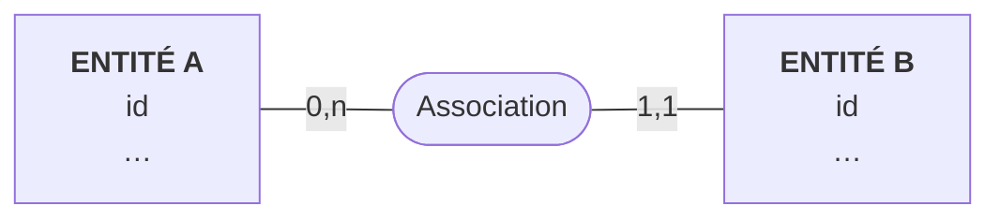

# La conception

<!-- Étapes 1 et 2 du TP. Remplacez tout ce qui est entre < >, supprimez ces commentaires. -->

## 1. Les règles de gestion

<!-- 8 à 12 règles, numérotées. Chacune dit un « au plus », un « au moins », un « toujours » ou un « facultatif ». -->

> **RG1.** …
> **RG2.** …

Les questions que nous nous sommes posées, et la réponse retenue :

| Question | Réponse | Ce que ça change dans le MCD |
|---|---|---|
| <Une catégorie peut-elle être vide ?> | <Oui : une catégorie se crée avant ses produits> | <0,n côté catégorie> |

## 2. Le MCD

<!-- En Mermaid, comme dans le cours, ou une image exportée (Looping, draw.io) dans docs/. -->

| Cardinalité | Règle |
|---|---|
| <un A … 0 à n B> | <RG2> |

## 3. Le MLD

<!-- Clé primaire soulignée, clé étrangère précédée de #. -->

- A (<u>id</u>, …)
- …

## 4. Ce que le schéma ne garantit pas

| Règle | Pourquoi le schéma ne suffit pas | Où nous la garantissons |
|---|---|---|
| <RG… : au moins un …> | | <une transaction, un trigger, le code> |

## 5. En bonus : le modèle dans <votre SGBD>, et les requêtes

<!-- Seulement si vous avez fait le bonus ; sinon supprimez cette partie. Si votre SGBD n'est pas relationnel : comment le MLD devient des documents, des clés, des tables par requête ou un graphe. -->

<Le modèle, avec un extrait de chaque structure.>

| Question de l'application | Requête (fichier dans `modele/`) |
|---|---|
| <la question 1> | |
| <la question 2> | |
| <la question 3> | |
